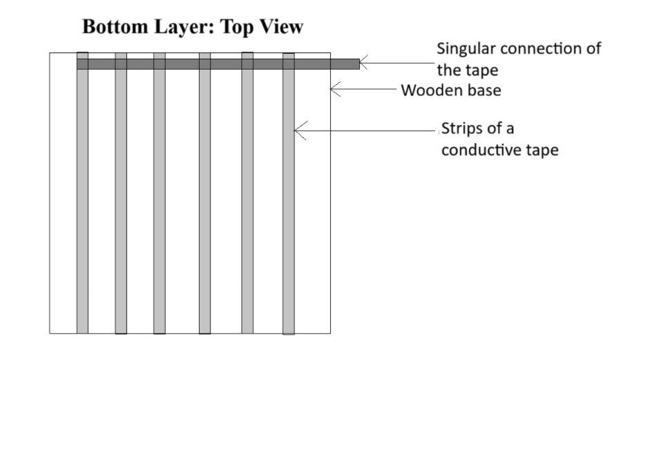

# Real-Time Transit Tracking (RTTT)

RTTT is a low-cost, camera-free passenger counter for city buses. A Velostat pressure mat at the door, paired with IR break-beam sensors, feeds an ESP32 that counts boarding and alighting passengers. The aim is live occupancy data for operators like Pune's PMPML, and later a SARIMA–LSTM occupancy forecast.

Published at **IEEE INDICON 2025**: G. Ghuge, A. Sinkar, S. Patil, S. Sagar, "Real Time Transit Tracking for Public Transportation", DOI [10.1109/INDICON68490.2025.11392965](https://doi.org/10.1109/INDICON68490.2025.11392965).

## Results (from the paper, controlled trials)

| Scenario | Trials | Ground truth | Counted | Accuracy | Direction error | False positives |
|---|---|---|---|---|---|---|
| Single-file entry | 100 | 100 | 98 | 98.0% | 1.0% | 0.0% |
| High-traffic stream | 50 | 250 | 235 | 94.0% | 3.2% | 1.5% |
| Crowded entry (2–3 at once) | 50 | 120 | 85 | 70.8% | 5.1% | 2.3% |
| Entry with baggage | 50 | 50 | 48 | 96.0% | 2.0% | 4.1% |
| Hesitation at doorway | 50 | 50 | 49 | 98.0% | 4.0% | 2.0% |
| **Overall** | 300 | 570 | 515 | **90.4%** | 3.2% | 1.7% |

Crowded entry is the known weak spot: a single-zone mat can't separate two people stepping on it together.

## Hardware

- ESP32-WROOM-32D (Wi-Fi), a DC-DC buck converter and a NEO-6M GPS. The paper estimates the cost at under ₹2,500 per unit.
- **Pressure mat**, built in-house: a Velostat sheet between two layers of conductive-tape strips laid at right angles, on a wooden base. Body weight lowers the Velostat's resistance, and the ESP32 reads it through an ADC pin. Drawings are in [`hardware/`](hardware).
- **Two IR break-beam sensors**, outer and inner. The order in which the beams break gives the direction, boarding or alighting.

| Side view | Top layer | Bottom layer |
|---|---|---|
|  |  |  |

## Firmware

### `firmware/rttt_sensor_fusion/` (main)

The full sensor-fusion node from Section III of the paper. Wiring and network settings are in `config.h`.

- **Direction:** `IR_OUTER → mat → IR_INNER` within 1.5 s is a boarding, and the reverse is an alighting. It runs as a state machine: `IDLE → AWAITING_PRESSURE → AWAITING_SECOND_IR → EVENT_COMPLETE`. Only a complete sequence counts, so luggage that only presses the mat and a passenger who steps in and turns back are both ignored.
- **Filtering:** the IR inputs are debounced (30 ms). The mat ADC goes through an 8-sample moving average and is compared with a threshold from a one-time calibration: over serial, `i` records the empty mat and `o` records one person standing on it. The calibration is saved in flash.
- **Lingering:** after an event, nothing new counts until the mat is released and both beams are clear, so one person counts once per crossing.
- **Crowding:** if the mat reading falls far below the one-person level, two or three people stepped on together. That still counts as one event, as in the paper, but is sent with `is_crowded_event: true`.
- **Output:** each event becomes the JSON payload below, with a GPS timestamp and position from the NEO-6M, or NTP time until the GPS has a fix.
  - The node runs its own Wi-Fi access point with a live dashboard: occupancy, boarded and alighted counts, position, and the event log, which can be downloaded as a text file.
  - If `WIFI_SSID` and `BACKEND_URL` are set, events are also HTTP POSTed to the backend, and queued while the node is offline.

Libraries: TinyGPSPlus. Everything else ships with the ESP32 Arduino core.

**Verification:** `tests/fusion_sim` runs the real sketch on a PC with mocked ESP32 APIs and scripted beam and mat inputs. The cases are boarding, alighting, a crowded entry, luggage only, turning back, lingering on the mat, and a sequence slower than the window. Running `make` there should print `PASS`. This firmware was written from the paper's design and has not yet been flashed onto the prototype.

### `firmware/pressure_mat_counter/` (earlier test sketch)

The mat-only counter from early prototype testing. It counts steps on GPIO34 and has a two-counter web page, with no IR or GPS. It is kept for reference.

## Media

- [`media/prototype_test.mp4`](media/prototype_test.mp4): prototype test
- [`media/preliminary_dashboard.mp4`](media/preliminary_dashboard.mp4): the web dashboard

## Data format (paper)

Each counted event is sent to the backend as JSON:

```json
{
  "timestamp": "2025-05-07T13:45:08Z",
  "bus_id": "PMPML_45",
  "latitude": 18.5000,
  "longitude": 73.8591,
  "event_type": "boarding",
  "current_occupancy": 34,
  "is_crowded_event": false
}
```

## Forecasting (planned)

The paper proposes a hybrid model. SARIMA handles the daily and weekly seasonality, and an LSTM learns the nonlinear residuals from weather, holidays and events, to forecast occupancy 24 hours ahead. It has not been implemented yet.

## Authors

Gajanan Ghuge, Anvay Sinkar, Sneha Patil and Snehal Sagar, Vishwakarma Institute of Technology, Pune.
