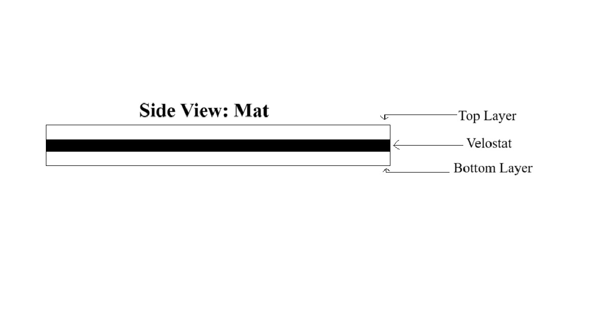
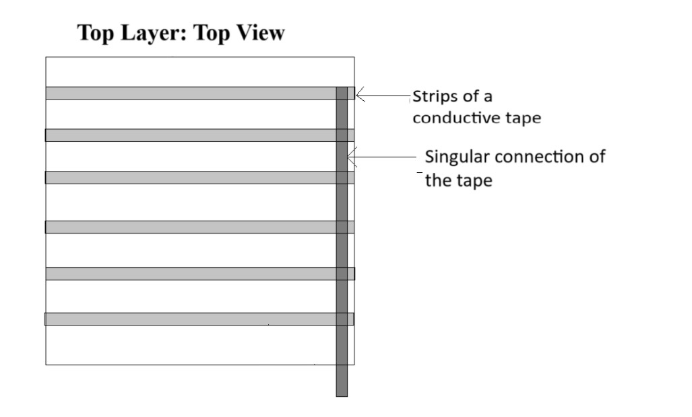

# Real-Time Transit Tracking (RTTT)

RTTT is a low-cost, camera-free passenger counter for city buses. A Velostat pressure mat at the door, paired with IR break-beam sensors, feeds an ESP32 that counts boarding and alighting passengers. The aim is live occupancy data for operators like Pune's PMPML, and later a SARIMA–LSTM occupancy forecast.

Published at **IEEE INDICON 2025**: G. Ghuge, A. Sinkar, S. Patil, S. Sagar, "Real Time Transit Tracking for Public Transportation", DOI [10.1109/INDICON68490.2025.11392965](https://doi.org/10.1109/INDICON68490.2025.11392965).

## Results (from the paper, controlled trials)

| Scenario | Trials | Ground truth | Counted | Accuracy | Direction error | False positives |
|---|---|---|---|---|---|---|
| Single-file entry | 100 | 100 | 98 | 98.0% | 1.0% | 0.0% |
| High-traffic stream | 50 | 250 | 235 | 94.0% | 3.2% | 1.5% |
| Crowded entry (2–3 at once) | 50 | 120 | 85 | 70.8% | 5.1% | 2.3% |
| Entry with baggage | 50 | 50 | 48 | 96.0% | 2.0% | 4.1% |
| Hesitation at doorway | 50 | 50 | 49 | 98.0% | 4.0% | 2.0% |
| **Overall** | 300 | 570 | 515 | **90.4%** | 3.2% | 1.7% |

Crowded entry is the known weak spot: a single-zone mat can't separate two people stepping on it together.

## Hardware

- ESP32-WROOM-32D (Wi-Fi), a DC-DC buck converter and a NEO-6M GPS. The paper estimates the cost at under ₹2,500 per unit.
- **Pressure mat**, built in-house: a Velostat sheet between two layers of conductive-tape strips laid at right angles, on a wooden base. Body weight lowers the Velostat's resistance, and the ESP32 reads it through an ADC pin. Drawings are in [`hardware/`](hardware).
- **Two IR break-beam sensors**, outer and inner. The order in which the beams break gives the direction, boarding or alighting.

| Side view | Top layer | Bottom layer |
|---|---|---|
|  |  |  |

## Firmware in this repo

[`firmware/pressure_mat_counter/pressure_mat_counter.ino`](firmware/pressure_mat_counter/pressure_mat_counter.ino) is the **pressure-mat counter used during prototype testing**. It does the following:

- reads the mat on GPIO34 every 10 ms
- counts a step when the reading drops below 700, then re-arms once the mat is released (reading 1000–4095), with a 700 ms cooldown
- runs a Wi-Fi access point with a web dashboard: two "bus stop" counters you can start and stop, a live clock, and a button to save the counts to a text file

It needs the ESPAsyncWebServer and AsyncTCP libraries.

The IR direction logic, GPS tagging and JSON upload to the cloud described in the paper are **not in this sketch**.

## Media

- [`media/prototype_test.mp4`](media/prototype_test.mp4): prototype test
- [`media/preliminary_dashboard.mp4`](media/preliminary_dashboard.mp4): the web dashboard

## Data format (paper)

Each counted event is sent to the backend as JSON:

```json
{
  "timestamp": "2025-05-07T13:45:08Z",
  "bus_id": "PMPML_45",
  "latitude": 18.5000,
  "longitude": 73.8591,
  "event_type": "boarding",
  "current_occupancy": 34,
  "is_crowded_event": false
}
```

## Forecasting (planned)

The paper proposes a hybrid model. SARIMA handles the daily and weekly seasonality, and an LSTM learns the nonlinear residuals from weather, holidays and events, to forecast occupancy 24 hours ahead. It has not been implemented yet.

## Authors

Gajanan Ghuge, Anvay Sinkar, Sneha Patil and Snehal Sagar, Vishwakarma Institute of Technology, Pune.
